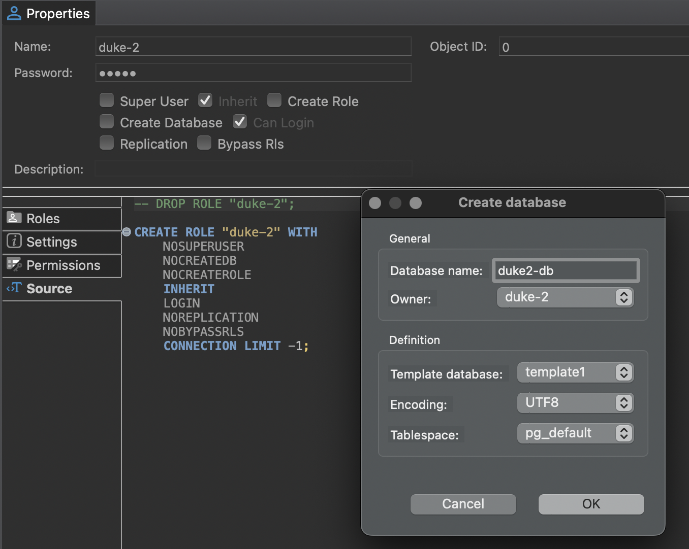

I have an AWS PostgreSQL instance serving a small web app. When building a new application, I wanted to reuse the existing instance to reduce costs. While I could share the same credentials across both applications, I decided to isolate them for security by creating a dedicated user and database. Here are the 2 methods I used:

## 1. Using Terminal

- Connect to database `template1`:

```
# psql -d template1 -U postgres
```

- Add a user called `tom`:

```
template1=# CREATE USER tom WITH PASSWORD 'myPassword';
```

Tip: Generate a random password with Node.js in the terminal:

```
node -e "console.log(crypto.randomBytes(16).toString('base64').replace(/\W/g, ''))"
```

- Add a database called `jerry_db`:

```
template1=# CREATE DATABASE jerry_db;
```

- Now grant all privileges on the database:

```
template1=# GRANT ALL PRIVILEGES ON DATABASE jerry_db to tom;
```

- To prevent other roles from creating objects in the `public` schema:

```
REVOKE ALL ON schema public FROM public;
```

- In practice, you will need to grant all privileges on the `public` schema to the new user:

```
GRANT ALL ON schema public TO tom;
```

- Type `\q` to quit:

```
template1=# \q
```

## 2. Using DBeaver GUI

- Create a new role with `Is User`, `Inherit`, and `Can Login`:

```
CREATE ROLE "duke2" WITH
	NOSUPERUSER
	NOCREATEDB
	NOCREATEROLE
	INHERIT
	LOGIN
	NOREPLICATION
	NOBYPASSRLS
	CONNECTION LIMIT -1;
```

- Create a new database and set its owner to the new user.



### References:

1. [https://www.cyberciti.biz/faq/howto-add-postgresql-user-account/](https://www.cyberciti.biz/faq/howto-add-postgresql-user-account/)

1. [https://www.postgresql.org/docs/current/sql-createrole.html](https://www.postgresql.org/docs/current/sql-createrole.html)

1. [https://tableplus.com/blog/2018/04/postgresql-how-to-grant-access-to-users.html](https://tableplus.com/blog/2018/04/postgresql-how-to-grant-access-to-users.html)
1. [https://dba.stackexchange.com/a/35317/113250](https://dba.stackexchange.com/a/35317/113250)
