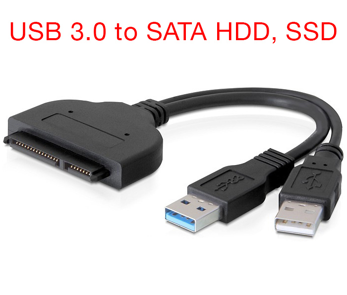

You don't need expensive dedicated NAS hardware to run a silent, reliable 24/7 home storage server. Retired tech sitting forgotten in your drawers—**an old PC, a discarded Android TV Box, or even an old smartphone**—can easily become a capable home NAS with headless torrent downloading and high-speed local file sharing.

### Choosing Your Hardware: PC vs. TV Box vs. Phone

| Device Type | Typical OS / Setup | Power Draw | Notable Advantages | Key Considerations |
| :--- | :--- | :--- | :--- | :--- |
| **Old PC / Laptop / Mini PC** | Ubuntu Server / Debian (`x86_64`) | 15W – 45W | Full SATA ports, Gigabit LAN, high CPU power | Higher power consumption; bulkier |
| **Old Android TV Box** *(Amlogic S905/S912, Rockchip)* | **Armbian** (Debian/Ubuntu for ARM) | 2W – 5W | Ultra-low power, silent fanless cooling, extremely cheap | Usually USB 2.0 or 3.0 ports; 100M/1G Ethernet |
| **Old Android Phone / Tablet** | **Termux** (`proot-distro`) or **postmarketOS** | 2W – 4W | **Built-in battery acts as a free UPS** against power cuts; built-in Wi-Fi & screen | Single USB port (requires powered USB-C OTG hub) |

Because Debian/Ubuntu bases (and Armbian/Termux-PRoot) share the exact same underlying Linux ecosystem, **the setup steps, permissions model, and configuration files in this guide are identical across all three platforms**.

---

## What We'll Build:
1. **Storage Setup**: Connecting SATA drives, 2.5" vs. 3.5" power requirements, TV box/phone brownout prevention, and auto-mounting.
2. **Server Hostname with `.local` Postfix**: Zero-configuration local network addressing (`nas.local`) via mDNS / Avahi.
3. Setting up a shared directory hierarchy with **group inheritance (SGID & ACLs)** so all future files and subfolders remain writable by your shared user group.
4. Installing and configuring **Transmission Daemon** for headless torrent downloading.
5. Setting up **Samba (SMB/CIFS)** for native network shares on Windows, macOS, Android, and iOS.
6. Setting up **FTP (vsftpd)** for legacy devices, automated backups, and camera uploads.
7. Securing everything with modern **nftables (`nft`)** firewall rules.

---

## 1. Storage Setup: Drives, Power Sources, and Mounting

When connecting extra storage to an old PC, TV box, or smartphone, you typically use an onboard SATA 3 port or a **USB 3.0 to SATA 3 adapter cable**.



### 2.5" vs. 3.5" Drives: The Critical Power Difference

One of the most common pitfalls when setting up DIY NAS storage with an external adapter is drive detection failure or unexpected reboots caused by **insufficient power**.

| Form Factor & Drive Type | Voltage Needed | Bus-Powered (USB Alone)? | External Power Source Needed? |
| :--- | :--- | :--- | :--- |
| **2.5-inch SATA SSD** | 5V DC (~0.5A - 1A) | **Yes** (on PCs with USB 3.0 delivering 5V @ 0.9A) | No (unless on low-power TV box/phone) |
| **2.5-inch Laptop HDD** | 5V DC (~1A) | **Yes** (on PCs with USB 3.0) | Recommended on TV box/phone |
| **3.5-inch Desktop HDD** | **5V DC + 12V DC** | **NO** (Standard USB only outputs 5V) | **YES: 12V DC Adapter strictly required** |

#### Why You Must Provide External Power for 3.5" Drives

1. **Dual-Voltage Architecture:**
   - A hard drive's PCB controller logic and cache memory operate on **5V DC**.
   - However, a 3.5" mechanical drive contains large, heavy aluminum platters and high-speed spindle motors (5,400 to 7,200 RPM) paired with a voice-coil actuator arm. These mechanical components strictly require **12V DC** to generate sufficient electromagnetic torque to spin up and seek.
2. **Standard USB Limitations:**
   - Standard USB 2.0 (500mA) and USB 3.0 (900mA) Type-A ports on PCs output **only 5V**. They cannot produce 12V natively.
3. **Symptoms of Missing Power:**
   - If you plug a 3.5" desktop HDD into a bus-powered USB-to-SATA adapter without connecting the **12V DC power brick**, the drive will produce faint clicking or buzzing noises, fail to spin up, and will **never show up under `lsblk`**.

#### Special Warning for Android TV Boxes & Smartphones: Brownout Prevention

If you are using an **old TV Box** or an **old phone/tablet**:
- **Do not rely on the device's USB port to power any mechanical hard drive.** The 5V bus power output on TV boxes and phones is designed for low-drain peripherals (flash drives, keyboards).
- When a mechanical hard drive (even a 2.5" laptop drive) spins up, its initial **inrush current** often exceeds 1.5A to 2A for a split second.
- On a phone or TV box, this current spike causes a **voltage brownout**, instantly crashing and rebooting the device!
- **Solution:** Always use a **powered USB hub** or a USB-to-SATA adapter with its own dedicated power adapter (12V for 3.5" drives, or a powered hub for 2.5" drives/phones). For smartphones, use a **USB-C OTG Hub with Power Delivery (PD)** so the phone charges while simultaneously connecting to the drive.

---

### Step 1.1: Identify the Disk

Connect your SATA drive to the device (and plug in the 12V DC power brick if using a 3.5" drive). Boot up your machine and list all block devices:

```shell
lsblk -f
```

You should see your primary OS drive (often `sda` or `nvme0n1`) and your newly attached SATA drive (for example, `sdb`).

```shell
NAME   FSTYPE FSVER LABEL UUID                                 FSAVAIL FSUSE% MOUNTPOINTS
sdb
```

### Step 1.2: Partition and Format the Disk

If the drive is fresh or needs reformatting with `ext4` (recommended for native Linux stability and POSIX permission support):

```shell
# Partition with fdisk or parted (GPT recommended)
sudo fdisk /dev/sdb
```

Inside `fdisk`:
- Type `g` to create a new GPT partition table.
- Type `n` to create a new partition (accept defaults for full capacity).
- Type `w` to write changes and exit.

Now format the partition `/dev/sdb1` with `ext4`:

```shell
sudo mkfs.ext4 -L "NAS_DATA" /dev/sdb1
```

> **Tip:** By default, `ext4` reserves 5% of space for root. On large multi-terabyte drives, that can waste tens of gigabytes. Reduce it to 1% with:
> ```shell
> sudo tune2fs -m 1 /dev/sdb1
> ```

### Step 1.3: Create a Mount Point and Configure `/etc/fstab`

Find the drive's UUID:

```shell
sudo blkid /dev/sdb1
```

Copy the `UUID="xxxxxxxx-xxxx-xxxx-xxxx-xxxxxxxxxxxx"` value.

Create your mount target (we will use `/srv/nas`):

```shell
sudo mkdir -p /srv/nas
```

Edit `/etc/fstab` to ensure the disk mounts automatically on boot:

```shell
sudo nano /etc/fstab
```

Add the following entry at the bottom:

```shell
UUID=xxxxxxxx-xxxx-xxxx-xxxx-xxxxxxxxxxxx /srv/nas ext4 defaults,noatime,nofail 0 2
```

- `noatime`: Avoids writing access timestamps whenever a file is read, reducing disk I/O and wear.
- `nofail`: Prevents the boot process from hanging if the drive is unplugged or fails to spin up.

Test the mount without rebooting:

```shell
sudo mount -a
df -h /srv/nas
```

---

## 2. Setup Server Name with `.local` Postfix (mDNS / Avahi)

Home Wi-Fi routers usually assign dynamic IP addresses via DHCP. If your router restarts or an IP lease expires, your NAS IP might change from `192.168.1.50` to `192.168.1.120`, breaking all your bookmarked browser links and mapped network drives.

Instead of tracking dynamic IPs or manually configuring DNS records, you can broadcast your NAS hostname with a **`.local` postfix** using **mDNS (Multicast DNS / Zeroconf)** via **Avahi**.

This allows every device on your network (macOS, iOS, Windows 10/11, and Linux) to reach your server by simply typing `nas.local`.

### Step 2.1: Set the Hostname

Set a clean, memorable hostname on your device (for example, `nas`):

```shell
sudo hostnamectl set-hostname nas
```

*(On minimalist systems or Termux where `hostnamectl` is not available, write directly to `/etc/hostname`: `echo "nas" | sudo tee /etc/hostname`).*

Next, update `/etc/hosts` to ensure local system utilities resolve the new name without delays:

```shell
sudo nano /etc/hosts
```

Ensure the loopback entries include `nas`:

```ini
127.0.0.1   localhost
127.0.1.1   nas
```

### Step 2.2: Install and Enable Avahi Daemon

Install `avahi-daemon` on Debian, Ubuntu, or Armbian:

```shell
sudo apt update
sudo apt install -y avahi-daemon avahi-utils
```

Enable and start the service:

```shell
sudo systemctl enable avahi-daemon
sudo systemctl restart avahi-daemon
```

### Step 2.3: Verify `.local` Resolution

Verify that Avahi is actively broadcasting your `.local` domain:

```shell
avahi-resolve -n nas.local
```

You should see output resolving `nas.local` to your machine's current local IP address.

From any laptop, phone, or desktop connected to the same Wi-Fi/LAN, test connectivity:

```shell
ping nas.local
```

Now, wherever an IP address was previously required, you can use `nas.local`:
- **SSH Access:** `ssh youruser@nas.local`
- **Transmission Web UI:** `http://nas.local:9091`
- **Samba File Shares:** `\\nas.local\NAS` (Windows) or `smb://nas.local/NAS` (macOS/Linux)
- **FTP Client:** `ftp://nas.local`

---

## 3. Directory Structure and Group Permissions with SGID

When running shared network folders alongside background services (like Transmission, Samba, or Jellyfin), **permission conflicts are the #1 headache**. If Transmission downloads a file with restrictive permissions, your regular user won't be able to move or delete it.

We solve this using **Linux User Groups**, the **SetGID (SGID) bit**, and **POSIX Default ACLs**.

### Step 3.1: Create a Shared Group

Create a unified group for all NAS consumers (e.g., `nas-users`) and add your daily user to it:

```shell
sudo groupadd nas-users
sudo usermod -aG nas-users $USER
```

*(Log out and log back in, or run `newgrp nas-users` so your session recognizes the new group).*

### Step 3.2: Establish the Directory Layout

Create logical folders inside the mounted drive:

```shell
sudo mkdir -p /srv/nas/downloads/incomplete
sudo mkdir -p /srv/nas/downloads/complete
sudo mkdir -p /srv/nas/media/{movies,tv,music}
sudo mkdir -p /srv/nas/documents
sudo mkdir -p /srv/nas/backups
```

### Step 3.3: Set Ownership and Group Inheritance (SGID)

Change the group ownership of `/srv/nas` to `nas-users`:

```shell
sudo chown -R $USER:nas-users /srv/nas
```

Now, enable the **SGID bit (2xxx)** on directories:

```shell
# Set directories to 2775 (rwxrwsr-x)
sudo find /srv/nas -type d -exec chmod 2775 {} +

# Set files to 0664 (rw-rw-r--)
sudo find /srv/nas -type f -exec chmod 0664 {} +
```

#### Why SGID (`chmod g+s` / `2775`)?
Normally, when a user creates a new file or subfolder, it inherits that user's primary group. With the **SGID bit** set on a parent directory, **any newly created subfolder or file automatically inherits the parent folder's group (`nas-users`)**, ensuring multi-user and daemon collaboration.

### Step 3.4: Guarantee Write Access with Default POSIX ACLs

While SGID ensures the *group name* is inherited, default file creation masks (umask) could still omit group write permissions. To ensure every future file and folder is always group-writable:

```shell
sudo apt install -y acl
sudo setfacl -R -d -m g:nas-users:rwx /srv/nas
sudo setfacl -R -m g:nas-users:rwx /srv/nas
```

Now, regardless of which tool or user creates a file inside `/srv/nas`, members of `nas-users` will maintain full read and write access!

---

## 4. Install and Configure Transmission Daemon

Transmission is lightweight, uses minimal CPU and RAM, and features a clean web interface accessible across your local network.

### Step 4.1: Install Transmission Daemon

```shell
sudo apt update
sudo apt install -y transmission-daemon
```

### Step 4.2: Stop the Service Before Modifying Config

> **Important:** Transmission writes its in-memory configuration back to disk when shutting down. If you edit `settings.json` while the service is running, **your changes will be completely overwritten**.

Always stop the service first:

```shell
sudo systemctl stop transmission-daemon
```

### Step 4.3: Find the Transmission System User & Add to `nas-users`

The system username under which `transmission-daemon` runs **differs depending on your Linux distribution**:

| Linux Distribution | Default User Name |
| :--- | :--- |
| **Debian / Ubuntu / Raspberry Pi OS / Linux Mint** | `debian-transmission` |
| **Arch Linux / Manjaro** | `transmission` |
| **Fedora / RHEL / Rocky Linux / AlmaLinux** | `transmission` |
| **Alpine Linux / openSUSE** | `transmission` |

If you are unsure of your distribution's exact username, you can discover it dynamically using any of the following commands:

```shell
# Method 1: Query systemd unit definition (recommended)
systemctl cat transmission-daemon | grep -i 'User='

# Or query the property directly:
systemctl show -p User transmission-daemon

# Method 2: Search for transmission in /etc/passwd
grep -i 'transmission' /etc/passwd

# Method 3: If the daemon was running, inspect the process owner
ps -eo user,comm | grep -i transmission
```

Once you have identified the user (we will assume `debian-transmission` for Debian/Ubuntu, or replace with `transmission` on Arch/Fedora/Alpine), add it to `nas-users`:

```shell
# Replace with 'transmission' if on Arch/Fedora/Alpine
TR_USER="debian-transmission"

sudo usermod -aG nas-users $TR_USER
```

Verify that the user is now in the group:

```shell
id $TR_USER
```

Output should show `groups=...,nas-users`.

### Step 4.4: Configure Transmission Settings

Open the configuration file:

```shell
sudo nano /etc/transmission-daemon/settings.json
```

Update the following key settings:

```json
{
    ...
    "download-dir": "/srv/nas/downloads/complete",
    "incomplete-dir": "/srv/nas/downloads/incomplete",
    "incomplete-dir-enabled": true,
    "umask": 2,
    "rpc-enabled": true,
    "rpc-port": 9091,
    "rpc-whitelist-enabled": false,
    "rpc-authentication-required": true,
    "rpc-username": "admin",
    "rpc-password": "YourStrongPasswordHere",
    ...
}
```

Key options explained:
- `"umask": 2`: Sets the decimal mask `2` (octal `002`). New files will be created with `664` (`rw-rw-r--`) and folders with `775` (`rwxrwxr-x`), allowing other members of `nas-users` to move or delete downloads.
- `"rpc-whitelist-enabled": false`: Allows connections from any IP on your local subnet (or you can set `"rpc-whitelist": "127.0.0.1,192.168.*.*"`).
- `"rpc-password"`: Enter your password in plaintext. Transmission will automatically hash it with SHA-1 when the daemon restarts.

### Step 4.5: Ensure Systemd UMask (Optional but Recommended)

Modern `systemd` unit files can enforce their own umask overriding Transmission's config. To ensure Transmission always writes group-writable files:

```shell
sudo systemctl edit transmission-daemon
```

Add the following override lines:

```ini
[Service]
UMask=0002
```

Save and exit.

### Step 4.6: Verify Permissions and Start the Daemon

Grant Transmission initial ownership over the download folders while maintaining group access:

```shell
# Uses $TR_USER from Step 4.3 (debian-transmission or transmission)
sudo chown -R $TR_USER:nas-users /srv/nas/downloads
sudo chmod -R 2775 /srv/nas/downloads
```

Reload systemd and start the daemon:

```shell
sudo systemctl daemon-reload
sudo systemctl start transmission-daemon
sudo systemctl enable transmission-daemon
```

---

## 5. Setup Samba (SMB/CIFS) for Cross-Platform File Sharing

Samba allows seamless access to `/srv/nas` directly from Windows Explorer, macOS Finder, Android, iOS, and smart TVs without extra client software.

### Step 5.1: Install Samba

```shell
sudo apt install -y samba
```

### Step 5.2: Configure the Samba Share

Back up the default configuration file:

```shell
sudo cp /etc/samba/smb.conf /etc/samba/smb.conf.bak
```

Edit `/etc/samba/smb.conf`:

```shell
sudo nano /etc/samba/smb.conf
```

Scroll to the bottom of the file and append our `[NAS]` share definition:

```ini
[NAS]
   comment = Home NAS Shared Storage
   path = /srv/nas
   browseable = yes
   read only = no
   guest ok = no
   valid users = @nas-users
   force group = nas-users
   create mask = 0664
   directory mask = 2775
   force create mode = 0664
   force directory mode = 2775
```

Why these parameters match our setup perfectly:
- `valid users = @nas-users`: Only system users who belong to the `nas-users` group are allowed to authenticate and access the share.
- `force group = nas-users`: Enforces group ownership on any newly uploaded file or directory.
- `create mask = 0664` & `directory mask = 2775`: Guarantees new files and folders retain group write permissions and the SGID bit.

### Step 5.3: Set Samba Password for Users

Samba maintains its own password database separate from Linux system login passwords. Add your user account to Samba:

```shell
sudo smbpasswd -a $USER
```

Enter a secure password when prompted.

If you want to add another family member or a dedicated user:

```shell
# Create system user without a home directory and add to nas-users
sudo useradd -M -s /usr/sbin/nologin -g nas-users family
# Set their Samba access password
sudo smbpasswd -a family
```

### Step 5.4: Restart and Enable Samba Services

```shell
sudo systemctl restart smbd nmbd
sudo systemctl enable smbd nmbd
```

### Step 5.5: Connecting to the Share

Thanks to our `.local` hostname from Section 2, connecting is simpler than ever:
- **Windows:** Open File Explorer or press `Win + R`, then enter `\\nas.local\NAS` (or `\\<NAS_IP>\NAS`). Log in using your username and the password created with `smbpasswd`.
- **macOS:** In Finder, press `Cmd + K`, enter `smb://nas.local/NAS`, and click **Connect**.
- **Linux:** Open your file manager (Nautilus, Dolphin) and navigate to `smb://nas.local/NAS`.

---

## 6. Setup FTP (vsftpd) for Automated Transfers & Legacy Devices

While SMB is great for desktop file browsing, **FTP/SFTP** is ideal for legacy devices, IP security cameras streaming or archiving footage, microcontrollers, and fast batch automation scripts.

We will use `vsftpd` (Very Secure FTP Daemon), known for its lightweight footprint and high performance.

### Step 6.1: Install vsftpd

```shell
sudo apt install -y vsftpd
```

### Step 6.2: Configure vsftpd

Back up the default configuration:

```shell
sudo cp /etc/vsftpd.conf /etc/vsftpd.conf.bak
sudo nano /etc/vsftpd.conf
```

Replace or adjust the following configuration directives:

```ini
listen=NO
listen_ipv6=YES
anonymous_enable=NO
local_enable=YES
write_enable=YES
local_umask=002
dirmessage_enable=YES
use_localtime=YES
xferlog_enable=YES
connect_from_port_20=YES

# Lock local users into their chroot
chroot_local_user=YES
allow_writeable_chroot=YES

# Root directory for FTP sessions
local_root=/srv/nas

# Passive mode configuration for local network & firewalls
pasv_enable=YES
pasv_min_port=40000
pasv_max_port=40100
```

Key points:
- `local_umask=002`: This matches Transmission's umask! Any file uploaded through FTP will be created with `664` permissions (`rw-rw-r--`), so Transmission and Samba users can edit or delete them.
- `local_root=/srv/nas`: Drops FTP users directly into the NAS storage root.
- `pasv_min_port=40000` & `pasv_max_port=40100`: Limits passive port range, making firewall rules simple and predictable.

### Step 6.3: (Optional) Create a Dedicated FTP User for IP Cameras or Backups

If you have an IP camera or automated tool, avoid using your personal account. Create a restricted user:

```shell
sudo useradd -M -s /usr/sbin/nologin -g nas-users camuser
sudo passwd camuser
```

Because `camuser` belongs to `nas-users`, any footage uploaded to `/srv/nas` will automatically be accessible across Samba and your other tools!

### Step 6.4: Restart and Enable vsftpd

```shell
sudo systemctl restart vsftpd
sudo systemctl enable vsftpd
```

You can now connect via any FTP client (like **FileZilla**, **Cyberduck**, or the `ftp` CLI) using `ftp://nas.local` (or `ftp://<NAS_IP_ADDRESS>`).

---

## 7. Firewall Configuration with nftables (`nft`)

Modern Linux distributions (Debian 10+, Ubuntu 20.04+, and newer) use **nftables** as the default kernel packet filtering framework. Compared to legacy `iptables` and high-level wrappers like `ufw`, `nftables` features:
- A clean, unified syntax for both IPv4 and IPv6 (`inet` family).
- Atomic ruleset commits (no half-applied rule states).
- Native support for sets, ranges, and dictionary lookups, minimizing CPU overhead.

### Step 7.1: Install and Enable nftables

Install the `nftables` package and ensure any conflicting firewall frontends (like `ufw`) are disabled:

```shell
sudo apt update
sudo apt install -y nftables

# If UFW was enabled, disable it to prevent conflicting rules
sudo ufw disable
```

### Step 7.2: Configure `/etc/nftables.conf`

Back up the existing default template:

```shell
sudo cp /etc/nftables.conf /etc/nftables.conf.bak
sudo nano /etc/nftables.conf
```

Replace the content with the following comprehensive NAS ruleset:

```nft
#!/usr/sbin/nft -f

flush ruleset

table inet filter {
    # Define your trusted Local Area Network subnets
    # Adjust to your subnet (e.g., 192.168.1.0/24)
    define LAN_V4 = { 192.168.0.0/16, 10.0.0.0/8, 172.16.0.0/12 }

    chain input {
        type filter hook input priority filter; policy drop;

        # 1. Allow established and related traffic (state tracking)
        ct state established,related accept

        # 2. Drop invalid packets early
        ct state invalid drop

        # 3. Allow all traffic on loopback interface (localhost)
        iifname "lo" accept

        # 4. Allow ICMP (ping) for diagnostics
        ip protocol icmp accept
        ip6 nexthdr icmpv6 accept

        # 5. Admin access: SSH
        tcp dport 22 accept

        # 6. mDNS: Multicast DNS for .local hostname resolution (UDP 5353)
        udp dport 5353 accept

        # 7. Transmission BitTorrent Peer Traffic (must be open to all peers)
        tcp dport 51413 accept
        udp dport 51413 accept

        # -------------------------------------------------------------
        # LAN-Restricted Services (blocked from outside internet)
        # -------------------------------------------------------------

        # Transmission Web UI (9091)
        ip saddr $LAN_V4 tcp dport 9091 accept

        # Samba (SMB/CIFS)
        ip saddr $LAN_V4 tcp dport { 139, 445 } accept
        ip saddr $LAN_V4 udp dport { 137, 138 } accept

        # FTP (Control port 21 & Passive port range 40000-40100)
        ip saddr $LAN_V4 tcp dport 21 accept
        ip saddr $LAN_V4 tcp dport 40000-40100 accept

        # Reject all other incoming packets cleanly
        reject with icmpx type port-unreachable
    }

    chain forward {
        type filter hook forward priority filter; policy drop;
    }

    chain output {
        type filter hook output priority filter; policy accept;
    }
}
```

#### Why this configuration is secure:
- **Default Drop Policy:** Inbound connections are dropped unless explicitly permitted.
- **LAN Isolation:** Sensitive management endpoints (Transmission Web UI, Samba shares, and FTP) are only accessible from private IP addresses (`$LAN_V4`).
- **Zero-Config Resolution:** Opening UDP port `5353` allows `avahi-daemon` to answer mDNS queries so `nas.local` remains discoverable across your entire network.
- **Torrent Peer Access:** Only port `51413` (TCP/UDP) is open globally so other BitTorrent peers can seed and leech without exposing your internal services.

### Step 7.3: Validate and Apply the Ruleset

Before restarting the service, test your ruleset syntax to avoid locking yourself out:

```shell
# Dry-run check (returns silent if valid, or outputs errors with line numbers)
sudo nft -c -f /etc/nftables.conf
```

If the validation check succeeds, load the ruleset immediately:

```shell
sudo nft -f /etc/nftables.conf
```

Enable and restart the `nftables` systemd service so your rules persist across reboots:

```shell
sudo systemctl restart nftables
sudo systemctl enable nftables
```

### Step 7.4: Useful `nft` CLI Commands

Here are handy commands for inspecting and managing your firewall:

```shell
# View the full active ruleset
sudo nft list ruleset

# View the filter table only
sudo nft list table inet filter

# View rules with packet and byte counters
sudo nft -a list ruleset

# Temporarily flush all rules (for troubleshooting)
sudo nft flush ruleset
```

> **Note on UFW:** If you prefer `ufw`, the equivalent commands are `sudo ufw allow 22/tcp`, `sudo ufw allow 5353/udp`, `sudo ufw allow 51413`, `sudo ufw allow from 192.168.0.0/16 to any port 9091 proto tcp`, `sudo ufw allow from 192.168.0.0/16 to any port 139,445 proto tcp`, and `sudo ufw allow from 192.168.0.0/16 to any port 21,40000:40100 proto tcp`.

---

## 8. Verification: The Multi-Service Permission Test

The real test of a unified NAS setup is confirming that **every service respects the `nas-users` group and SGID inheritance**.

### Test 1: Transmission Web Interface
Open your browser from another computer on the same network:

```
http://nas.local:9091
```
*(or `http://<NAS_IP_ADDRESS>:9091`)*

Log in with your username (`admin`) and the password you set in `settings.json`.

### Test 2: File Creation Across Services
Let's test file creation across our three services:

1. **Transmission:** Creates a download file.
   ```shell
   sudo -u debian-transmission touch /srv/nas/downloads/complete/transmission_file.txt
   ```
2. **Samba:** Drag and drop a file named `samba_file.txt` from Windows or macOS into the `NAS` share.
3. **FTP / Local User:** Upload a file via FTP or touch one locally:
   ```shell
   touch /srv/nas/documents/user_file.txt
   ```

Now check ownership and permissions inside `/srv/nas`:

```shell
ls -l /srv/nas/downloads/complete/transmission_file.txt
ls -l /srv/nas/documents/user_file.txt
```

Expected output:
```shell
-rw-rw-r-- 1 debian-transmission nas-users 0 Nov 12 11:38 transmission_file.txt
-rw-rw-r-- 1 youruser            nas-users 0 Nov 12 11:38 user_file.txt
```

Notice:
- Both files belong to the **`nas-users`** group automatically.
- Both files have **`rw-rw-r--`** permissions.
- Any user in `nas-users` can modify, move, or delete files created by any other service!

---

## 9. Next Steps

With your storage mounted, `.local` domain broadcasting, Transmission downloading headlessly, Samba sharing across all personal devices, and FTP open for camera feeds or script automations:

- **Media Streaming**: Spin up a Docker container with **Jellyfin** or **Plex**, mounting `/srv/nas/media` and `/srv/nas/downloads/complete` as read-only volumes.
- **Automation (*arr Stack)**: Install Sonarr and Radarr to automatically send torrents to Transmission and organize them into `/srv/nas/media`.
- **Disk Health Monitoring**: Install `smartmontools` (`sudo apt install smartmontools`) and run periodic health checks on your SATA drive (`sudo smartctl -H /dev/sdb`).

Enjoy breathing new life into your old hardware!

---

## Author's Note

> **Note:** This tutorial was written with AI assistance under hands-on human technical guidance and real-world testing.
>
> The setup, permission architecture, and firewall rules in this guide were verified and deployed on an **H96 MAX TV Box (Rockchip)**:
> - **Processor (SoC):** Rockchip RK3318 (Quad-Core 64-bit ARM Cortex-A53 @ up to 1.5 GHz)
> - **GPU:** Mali-450 Penta-Core
> - **Memory (RAM):** 4 GB DDR3
> - **Internal Storage:** 32 GB / 64 GB eMMC (flashed with Armbian Server)
> - **Connectivity:** 100M Ethernet, Dual-Band 2.4G/5G Wi-Fi, Bluetooth 4.0
> - **I/O Ports:** 1x USB 3.0 (connected to the SATA 3 adapter), 1x USB 2.0, TF/MicroSD slot
> - **Operating System:** Armbian (Debian/Ubuntu Server port for Rockchip RK3318/RK3328)
> - **Storage Attached:** 3.5" SATA 3 HDD via an externally powered (12V/2A DC) USB 3.0 to SATA adapter
